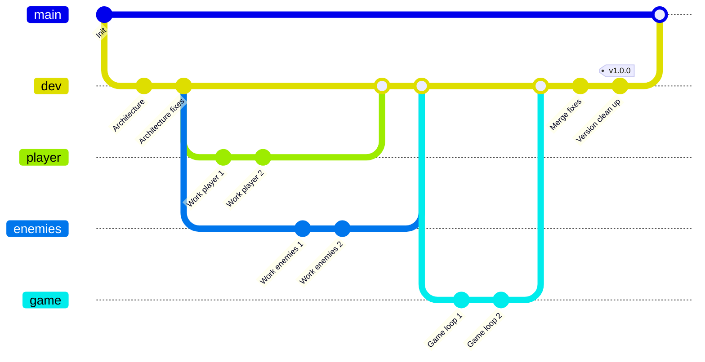

# OOP-Courses

## Théorie
[Reference pour la théorie](https://www.geeksforgeeks.org/cpp/c-plus-plus/)

## Projet

L'objectif est de refaire le [précédent projet](https://github.com/HeartBeat-Games/Imperative-Programming-CPP) en orienté objet, avec quelques fonctionnalités supplémentaires. L'architecture du projet est imposée et disponible ci-dessous avec la description des nouvelles fonctionanlités.

## Git flow

La gestion de votre répertoire git est imposée de la manière suivante :

## Coding style

Le travail de groupe permet d'introduire les conventions de code : [Convention par défaut](Project/CodingStyleCPP.md). Le nombre de **caractères par ligne (90)** et le nombre de **lignes par fonction (25)** n'est pas modifiable. Pour le reste, il faut juste que l'intégralité du code du groupe respecte la convention qui sera disponible dans le répertoire du projet.

## Tests unitaires

**Ceci n'est pas une obligation du projet**. Mais si vous voulez tester rapidement un morceau spécifique de code, et être sur que rien n'est cassé quand vous ajoutez des choses, je vous recommande de vous pencher sur un outil de tests unitaires comme [GoogleTests](https://google.github.io/googletest/).